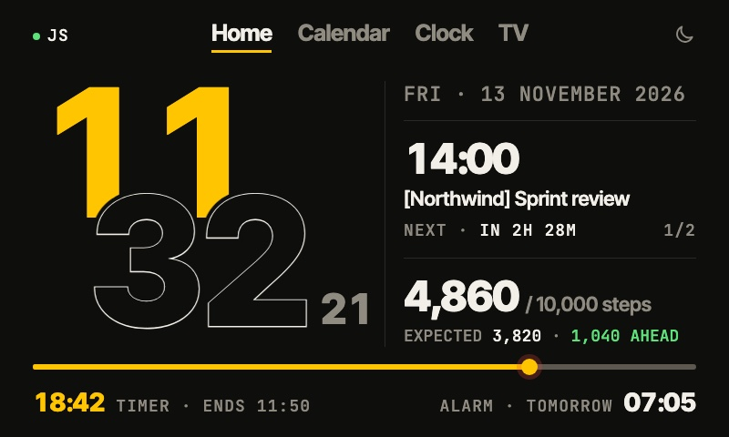
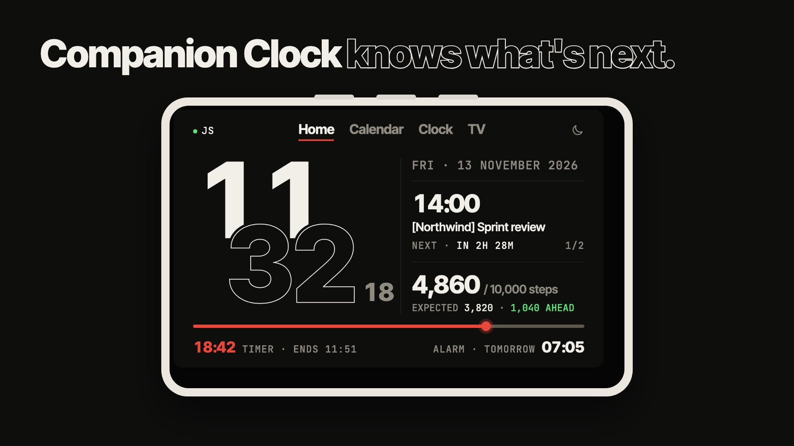
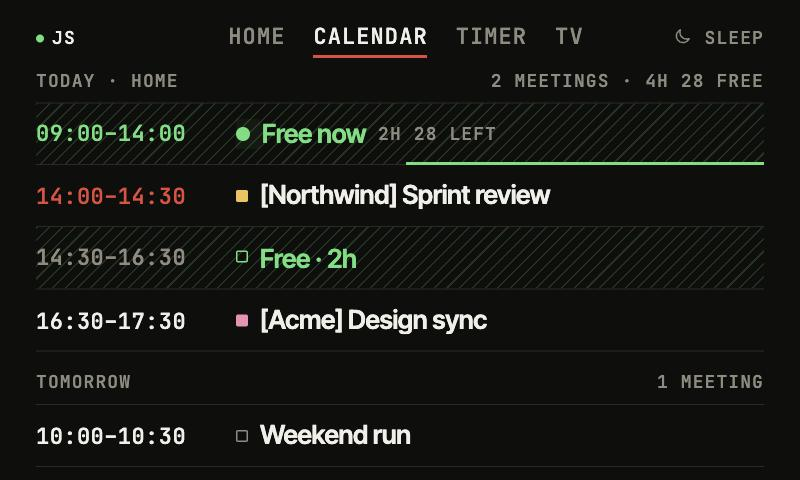
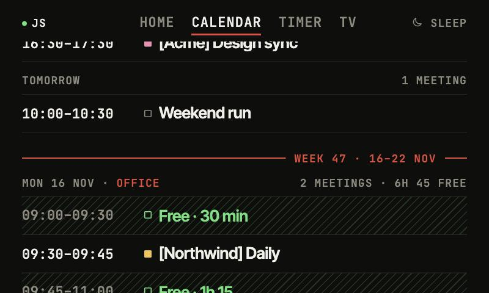
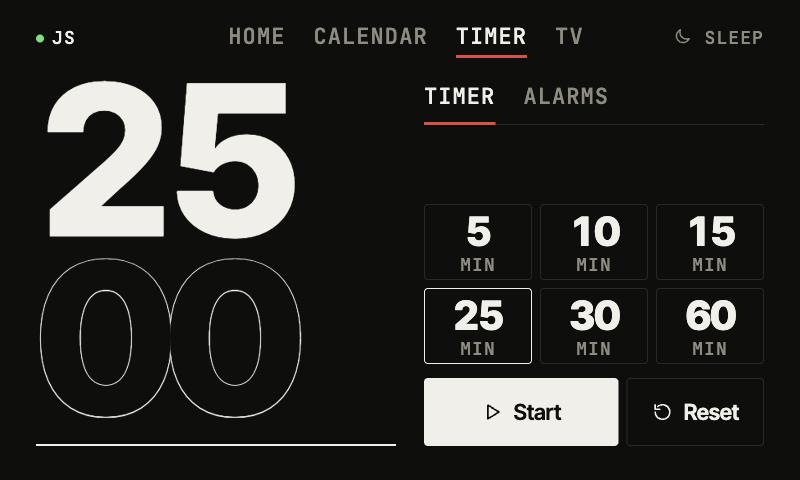
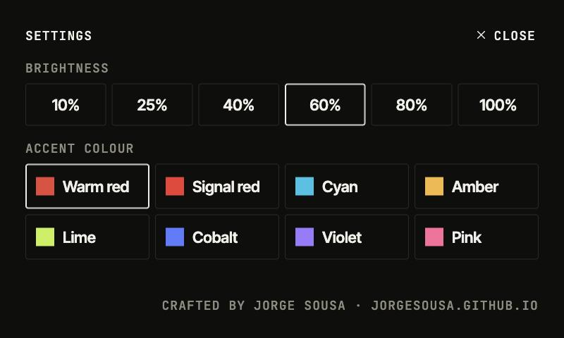

# Companion Clock

**The clock on your desk that knows what's next.**

A Xiaomi Mi Smart Clock turned into a work companion: the time, your next meeting and the free time around it, your steps, timers, alarms and a TV player, all served from the clock itself.

---

## Why

A desk clock sees you all day, and all it knew was the time. Companion Clock answers the next three questions at a glance, from a metre away: **what time is it, what's next, am I moving enough.** Everything else (a timer, an alarm, a channel) is one tap away.

## In 20 seconds

Click to play (with sound). Fictional data.

## A look around

<table>
<tr>
<td width="50%" valign="top">

<b>Calendar.</b> Today to the end of next week. Free time between meetings is hatched in green, and the slot you're in right now counts down.
</td>
<td width="50%" valign="top">

<b>Next week.</b> A rule with the week number marks where it starts. Office days stand out in the day's heading.
</td>
</tr>
<tr>
<td width="50%" valign="top">

<b>Clock.</b> One timer with one-tap presets, and one alarm set with big steppers.
</td>
<td width="50%" valign="top">

<b>Settings.</b> The sliders icon next to Sleep: brightness, eight accent colours, muting the TV during meetings, and Weather Live / Off.
</td>
</tr>
</table>

Screenshots use fictional clients and data.

## What it does

- **Home.** Hours solid in the accent colour, minutes outlined, seconds beside them. The colour travels: when a meeting is close or on, or a timer is in its last minute, the hours turn white and the colour stays only on what needs you. The next meeting, with "in 12 min"; 15 minutes before it the time turns to the accent and a line burns down to the start. While a meeting runs, a dot pulses and the same line fills as it goes. Swipe or tap to see today's later meetings. Long titles glide to show the end. With nothing left today it says Free; tap it to see when the next meeting is ("Until Mon 09:00"). From Friday's end of work (after its last meeting) until Monday it says Weekend instead, with Monday's first meeting underneath ("Back Mon 09:30").
- **Bottom strip.** The timer and the alarm, always on Home. A running timer burns down as a fuse; drag its spark back to the start to cancel it. With nothing set it says so ("No timer", "No alarm set"). Tap it to open Clock.
- **Weather in the digits.** Rain runs inside the outlined minutes, lightning lights the digits, snow drifts, the hours warm up in the sun, stars twinkle on a clear night. In Portugal, rain is checked against the nearest IPMA station: if it measured nothing in the last hour, the digits show an overcast sky instead. The temperature sits in the header; tap it and the meeting card turns into the weather: what it's like now, the day's high and low, the chance of rain and what the nearest IPMA station measured. Settings can make the tap switch to a second place instead (the UK by default). Each calendar day shows its forecast high. In Portugal, an IPMA weather warning for your district (yellow, orange or red: rain, wind, thunder, fog, snow, heat, cold) turns the temperature to its colour, outlined while it's still to come (up to three days ahead). Tap the temperature and the meeting card turns into the warning, hatched in its colour: what, until when, and IPMA's own sentence. Data from [Open-Meteo](https://open-meteo.com) and [IPMA](https://api.ipma.pt), no key needed. Settings has Weather Live / Off; Sleep always shows it.
- **A friend.** Tap the seconds and the Minder (Mindera's mascot) peeks out from a hiding place, leaning or lying down, looks around, blinks and hides again. Tap "Weekend" and fireworks go off inside the card.
- **Work and Personal.** Tap "JS" to switch. The new accent washes out from "JS" and hits the hours; the lines above and below the card light up and run across, the old card blurs away and the new one rises into focus. WORK shows your work calendar and meetings (TV hidden); PERSONAL shows your personal calendar, TV, and a Sporting card instead of the meeting: the next match (live score while it's on, the line burning down 15 minutes before kick-off), the league position, the last result. Each mode keeps its own accent; the brand slot is Mindera in WORK and Sporting in PERSONAL.
- **Colour has a job.** White is a value, grey is a label, colour is a state (now, soon, free, behind).
- **Health: steps and water.** A card with pages. Steps: today's count and how many to go. Water (work days): it stays out of sight while you're drinking enough; fall behind (glasses spread from 09:00 to 17:00) and the card turns to "Time for water" by itself, the water rising inside it and the accent travelling to it. Tap when you drink: "+1", the water drains and the card goes back to steps (tap again straight away to take it back). Swipe to look at the water any time; swiping the reminder away snoozes it for 15 minutes. Settings → Health sets the steps a day (6,000 to 15,000) and the glasses of 250 ml (6 to 12).
- **Calendar.** Grouped by day, with a summary per day ("4 meetings · 4h free"). Free time is counted inside the working day (09:00–17:00, Monday to Friday) in gaps of 15 minutes or more. Each client in `[Brackets]` gets its own colour, or its brand colour if you set one.
  A meeting's time turns to the accent only when it's on now or starts within 30 minutes.
- **Working location.** Google Calendar's Home / Office shows in each day's heading; Office in white.
- **Clock.** One timer (presets from 5 to 60 minutes) and one alarm. Both ring full-screen until you pull the sheet down.
- **Sleep.** One button turns the screen into a calm, centred clock in the same staircase as Home, with the next alarm and the weather.
- **TV.** Plays an HLS playlist (M3U) you provide. Ships with no channels; use only playlists you're entitled to.
- **Settings.** Brightness 10–100%, eight accent colours (one can be your company's, set in `config.json`), muting the TV in meetings, Weather Live / Off, what a tap on the temperature does, and Health goals, remembered on the clock.

## How it works

- **One HTML file.** [`index.html`](index.html) holds the whole app: inline CSS, JavaScript and SVG icons. It targets the clock's WebView 74, so no `?.`, `??`, `inset`, `clamp()` or flex `gap`.
- **Served from the clock.** [`device/serve.sh`](device/serve.sh) is a tiny HTTP server on `127.0.0.1:8080`, run by the clock's own `nc`. It serves the page, the config, self-hosted fonts and hls.js, the playlist proxy and a brightness endpoint. Nothing is hosted anywhere else.
- **Starts itself.** [`device/boot.sh`](device/boot.sh) runs at boot: it starts the server, restarts it if it ever stops, keeps the kiosk browser in front, and resets the touch panel if it gets stuck.
- **Calendar.** A Google Apps Script web app in your own account ([`calendar/Code.gs`](calendar/Code.gs)) returns your events as JSON, guarded by a random key. The clock asks for it every 5 minutes.
- **Steps.** Read from an [ntfy.sh](https://ntfy.sh) topic that your phone posts to (for example with [Unsit](https://github.com/jorgesousa/Unsit)).
- **Personal side.** A second Apps Script in a personal Google account ([`personal/Code.gs`](personal/Code.gs)) serves the personal calendar. Football (every competition, live scores, the league table) comes straight from ESPN's public API, no key.
- **Private values stay on the clock.** The calendar URL and key, the steps topic, your coordinates and the playlist URL live only in the clock's `config.json` and `m3u.url`, never in this repo. See [`config.example.json`](config.example.json).

## Install

Companion Clock runs on a Mi Smart Clock that you've already set up with root access (Magisk) and [Fully Kiosk Browser](https://www.fully-kiosk.com). Unlocking a device can void its warranty; do it only on your own device and at your own risk. This repo doesn't cover that step.

Then follow [docs/setup.md](docs/setup.md): copy the files to the clock, add your `config.json`, point Fully at `http://localhost:8080/`, and deploy the calendar script.

## Credits

Crafted by [Jorge Sousa](https://jorgesousa.github.io). Built with [Claude](https://claude.ai). Type: [Inter Tight](https://github.com/rsms/inter) and [JetBrains Mono](https://www.jetbrains.com/lp/mono/) (SIL Open Font License). Video: [hls.js](https://github.com/video-dev/hls.js) (Apache 2.0).

## License

[Sustainable Use License 1.0](LICENSE.md): free for personal and non-commercial use.
