<div align="center">

# Companion Clock

**The clock on your desk that knows what's next.**

A Xiaomi Mi Smart Clock turned into a desk companion with two lives. At work: the time, your next meeting and the free time around it, your steps and water. After hours: your own calendar, your club and TV. At night, a dim clock you can sleep next to. All served from the clock itself.

[](https://github.com/jorgesousa/companion-clock/actions/workflows/check.yml)


[](LICENSE.md)

<a href="https://github.com/jorgesousa/companion-clock/raw/main/docs/video/tour.mp4"></a>

<sub>▶ <a href="https://github.com/jorgesousa/companion-clock/raw/main/docs/video/tour.mp4">Watch with sound</a> · 35 seconds · fictional data</sub>

</div>

---

## Why

A desk clock sees you all day, and all it knew was the time. Companion Clock answers the next three questions at a glance, from a metre away: **what time is it, what's next, am I moving enough.** Everything else (a timer, an alarm, a channel) is one tap away.

## The first 20 seconds

<a href="https://github.com/jorgesousa/companion-clock/raw/main/docs/video/companion-clock.mp4">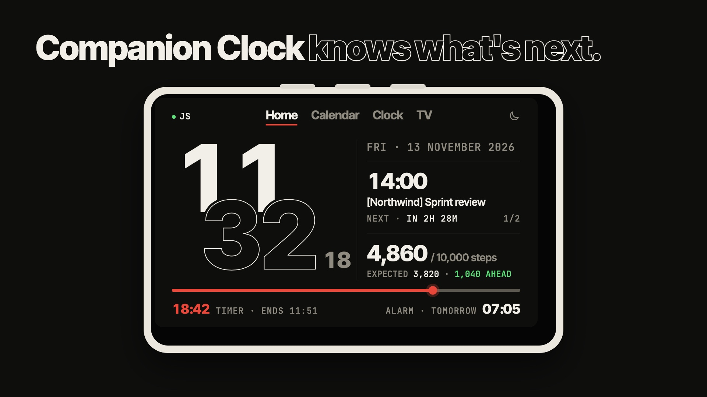</a>

<sub>▶ <a href="https://github.com/jorgesousa/companion-clock/raw/main/docs/video/companion-clock.mp4">Watch with sound</a> · 20 seconds · meetings, the fuse and free time · fictional data</sub>

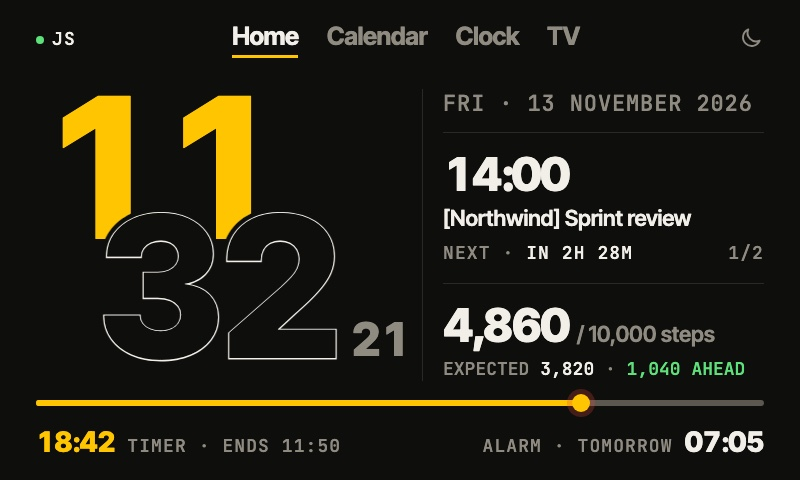

## A look around

<table>
<tr>
<td width="50%" valign="top">
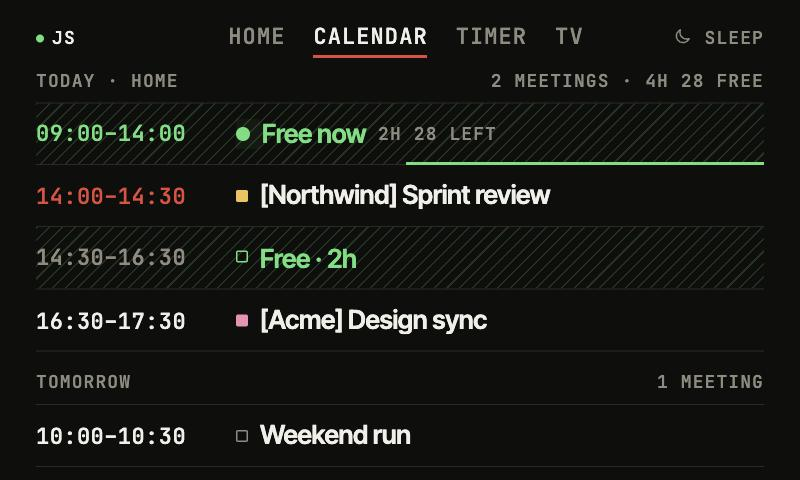
<b>Calendar.</b> Today to the end of next week. Free time between meetings is hatched in green, and the slot you're in right now counts down.
</td>
<td width="50%" valign="top">
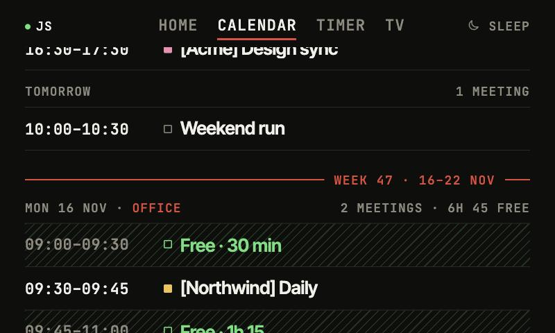
<b>Next week.</b> A rule with the week number marks where it starts. Office days stand out in the day's heading.
</td>
</tr>
<tr>
<td width="50%" valign="top">
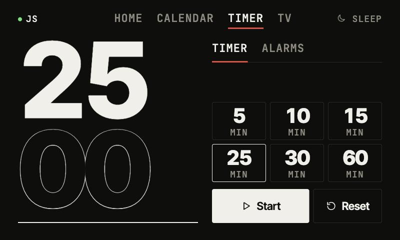
<b>Clock.</b> One timer with one-tap presets, and one alarm set with big steppers.
</td>
<td width="50%" valign="top">
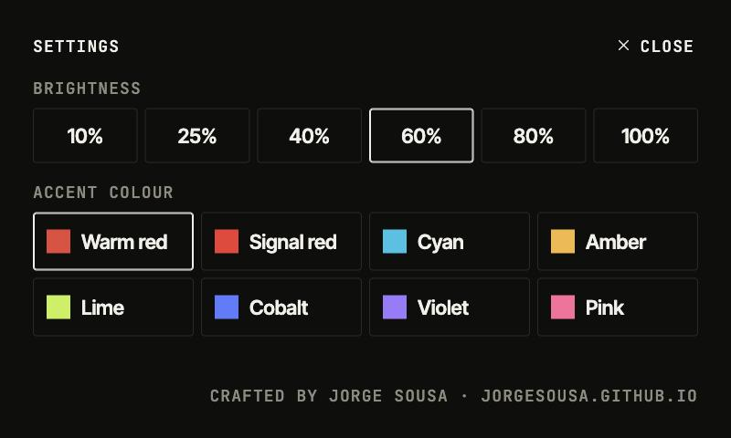
<b>Settings.</b> The sliders icon next to Sleep: brightness, eight accent colours, muting the TV during meetings, and Weather Live / Off.
</td>
</tr>
</table>

<sub>Screenshots use fictional clients and data.</sub>

## What it does

- **Home.** Hours solid in the accent colour, minutes outlined, seconds beside them. The colour travels: when a meeting is close or on, or a timer is in its last minute, the hours turn white and the colour stays only on what needs you. The next meeting, with "in 12 min"; 15 minutes before it the time turns to the accent and a line burns down to the start. While a meeting runs, a dot pulses and the same line fills as it goes. Swipe or tap to see today's later meetings. Long titles glide to show the end. With nothing left today it says Free; tap it to see when the next meeting is ("Until Mon 09:00"). From Friday's end of work (after its last meeting) until Monday it says Weekend instead, with Monday's first meeting underneath ("Back Mon 09:30").
- **Bottom strip.** The timer and the alarm, always on Home. A running timer burns down as a fuse; drag its spark back to the start to cancel it. With nothing set it says so ("No timer", "No alarm set"). Tap it to open Clock.
- **Weather in the digits.** Rain runs inside the outlined minutes, lightning lights the digits, snow drifts, the hours warm up in the sun, stars twinkle on a clear night. In Portugal, rain is checked against the nearest IPMA station: if it measured nothing in the last hour, the digits show an overcast sky instead. The temperature sits in the header; tap it and the meeting card turns into the weather: what it's like now, the day's high and low, the chance of rain and what the nearest IPMA station measured. Settings can make the tap switch to a second place instead (the UK by default). Each calendar day shows its forecast high. In Portugal, an IPMA weather warning for your district (yellow, orange or red: rain, wind, thunder, fog, snow, heat, cold) turns the temperature to its colour, outlined while it's still to come (up to three days ahead). Tap the temperature and the meeting card turns into the warning, hatched in its colour: what, until when, and IPMA's own sentence. Data from [Open-Meteo](https://open-meteo.com) and [IPMA](https://api.ipma.pt), no key needed. Settings has Weather Live / Off.
- **A friend.** Tap the seconds and the Minder (Mindera's mascot) peeks out from a hiding place, leaning or lying down, looks around, blinks and hides again. Tap "Weekend" and fireworks go off inside the card.
- **Work and Personal.** Tap "JS" to switch. The new accent washes out from "JS" and hits the hours; the lines above and below the card light up and run across, the old card blurs away and the new one rises into focus. WORK shows your work calendar and meetings (TV hidden); PERSONAL shows your personal calendar, TV, and a Sporting card instead of the meeting: the next match (live score while it's on, the line burning down 15 minutes before kick-off), the league position, the last result, and, if you turn on Settings → Club logo, the club's crest as a large monochrome backdrop that a slow sheen crosses now and then. Each mode keeps its own accent; the brand slot is Mindera in WORK and Sporting in PERSONAL.
- **Colour has a job.** White is a value, grey is a label, colour is a state (now, soon, free, behind).
- **Health: steps and water.** The card splits in two equal halves: today's steps and how many to go, and on work days in WORK mode the glasses of water you've drunk ("4 / 9"). On weekends and in PERSONAL the steps take the whole card. Tap the glasses when you drink: a line runs along the top and the number pops to the new count, as when you tap the steps. Tap again straight away to take it back, or hold for a moment to remove a glass any time. Fall behind on a work day (glasses spread from 09:00 to 17:00) and the water half floods with the accent, "Drink water", with a short chime (never during a meeting: it waits for it to end); the colour travels to it. Tap it when you drink and the reminder crumbles into grain from your finger, loosens, then bursts and falls away. Settings → Health sets the steps a day and the glasses of 250 ml.
- **Calendar.** Grouped by day, with a summary per day ("4 meetings · 4h free"). Free time is counted inside the working day (09:00–17:00, Monday to Friday) in gaps of 15 minutes or more. Each client in `[Brackets]` gets its own colour, or its brand colour if you set one.
  A meeting's time turns to the accent only when it's on now or starts within 30 minutes.
- **Working location.** Google Calendar's Home / Office shows in each day's heading; Office in white.
- **Clock.** One timer (presets from 5 to 60 minutes) and one alarm. When one rings, a card in the accent rises in the middle of the dimmed screen: the time in the Home type (hours solid, minutes outlined), what's ringing, and for an alarm a line for the day ahead (where you work, the first meeting, the weather), gliding if it's long. It beats with the beeps. Tap it to stop: it crumbles into grain from your finger, like the water reminder. From Sleep, the screen brightens over 30 seconds while it rings, and stopping it wakes you to Home.
- **Meeting heads-up.** In WORK, 5 minutes before each meeting (back-to-back ones too), the same card shows the meeting's start time, "Meeting · in 5 min" and its title, with one soft chime. Tap to crumble it; otherwise it crumbles by itself when the meeting starts. Once per meeting, never over an alarm or a timer, never in Sleep.
- **Sleep.** One button (or the night hours) turns the screen into a clock for a dark bedroom: the same staircase as Home, hours and minutes only, in one dim ember red on true black. No seconds, no weather, no mode colour, nothing that moves; just the next alarm underneath.
- **TV.** Plays an HLS playlist (M3U) you provide. Ships with no channels; use only playlists you're entitled to.
- **Settings.** Brightness 10–100%, eight accent colours (one can be your company's, set in `config.json`), muting the TV in meetings, Weather Live / Off, what a tap on the temperature does, the club logo on or off, and Health goals, remembered on the clock.

## Under the hood

No build step, no framework, no backend of its own. One HTML file, a 35-line shell HTTP server and a boot script, running on a 2019 smart clock. The interesting parts are the constraints.

| | |
|---|---|
| **Screen** | 800 × 480 CSS px (`width=800` viewport on a 1.5 DPR panel) |
| **Engine** | Android WebView 74 inside Fully Kiosk Browser |
| **App** | [`index.html`](index.html): inline CSS, JS and SVG, ES5-style, no dependencies except hls.js for TV |
| **Server** | [`device/serve.sh`](device/serve.sh), spawned per connection by toybox `nc -L` on `127.0.0.1:8080` |
| **Supervisor** | [`device/boot.sh`](device/boot.sh), a Magisk `service.d` script |
| **Feeds** | Two Google Apps Script web apps (work and personal calendars), ntfy.sh, Open-Meteo, IPMA, ESPN |

### Architecture

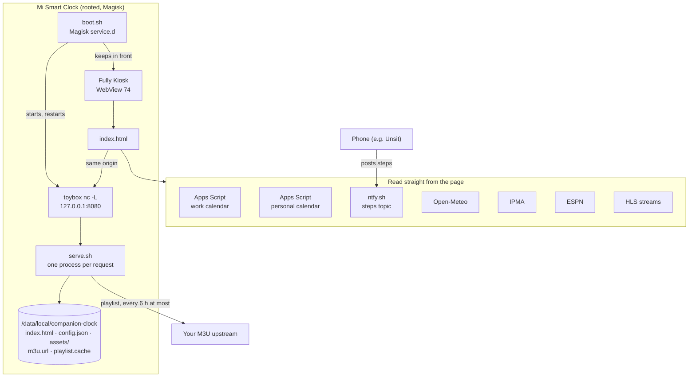

Everything the page loads from the clock is same-origin (`config.json`, fonts, hls.js, the playlist, the brightness endpoint). Everything else is a CORS-readable public API or your own Apps Script.

### The server: an HTTP router in POSIX sh

`nc -L` forks `serve.sh` for every connection with the socket on stdin/stdout. The script reads the request line, drains the headers and answers with HTTP/1.0 and `Connection: close`.

| Route | What it does |
|---|---|
| `/` · `/index.html` | The app, `Cache-Control: no-cache` |
| `/config.json` | The clock's private config (`chmod 600`, never in git) |
| `/a/<name>` | Fonts, CSS and hls.js from `assets/`. The name must match `[A-Za-z0-9.-]`, can't start with `.`, and must be `.woff2`, `.css` or `.js`: no path traversal. Cached for a year |
| `/bright?v=0..255` | Runs as root: `settings put system screen_brightness` (auto-brightness off), answers `204` |
| `/playlist.m3u` | A caching proxy for your IPTV playlist: if the cache is older than 6 h, it fetches `m3u.url` with a hand-written HTTP/1.0 request through `nc`, keeps it only on a `200`, strips the headers, then serves the cache |
| anything else | `404` |

The page is why brightness is an HTTP call: a WebView can't change system settings, but a root shell one socket away can.

### Boot and supervision

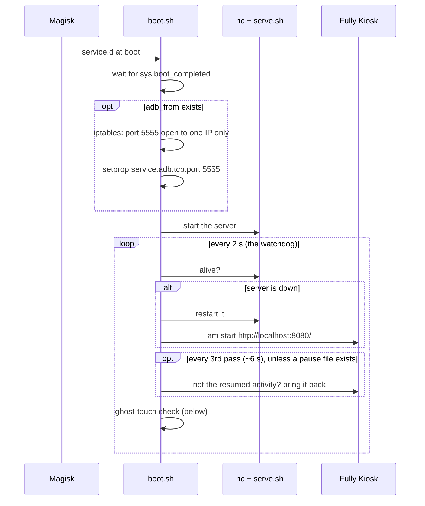

### Ghost-touch watchdog

Some clocks' `tlsc6x` touch panels get stuck reporting a touch with no finger on them, and real taps stop getting through. `boot.sh` detects it from the interrupt counter and the driver's own `dmesg` reports:

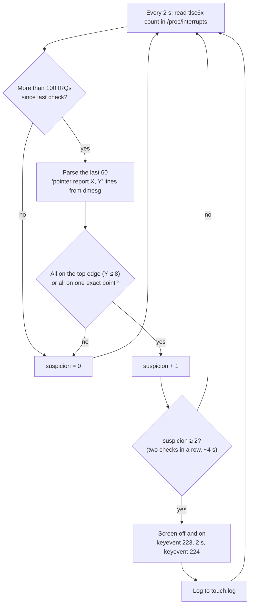

Two checks in a row means a finger held still on a stepper isn't taken for a stuck panel: a real finger always moves a little. Unbinding and rebinding the driver also resets the panel, but it leaves a dangling `tlsc6x_wakelock` in the kernel. The next time Android reads the wakelock list, `system_server` hangs and the hardware watchdog reboots the clock (`sys.boot.reason = reboot,wdt_hw`). That one was found by reading the watchdog dumps in `/data/system/dropbox`.

### App startup and the refresh loops

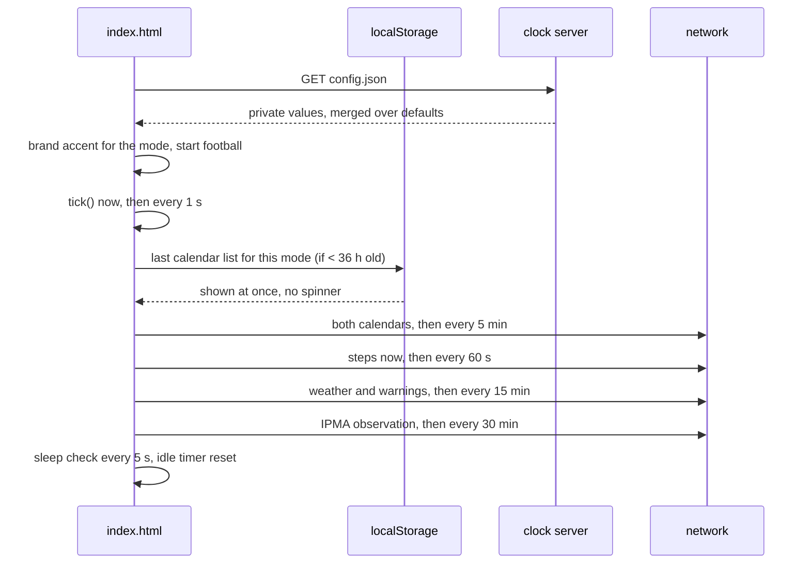

| Loop | Interval | Does |
|---|---|---|
| `tick` | 1 s | Clock digits, the meeting line, mute in meetings, the `attn` state; on each new minute: the next meeting, alarms, sleep |
| `fetchSteps` | 60 s | Polls the ntfy topic for the last 12 h and keeps the last message only if it's from today |
| `renderWater` | 30 s | Whether you're behind on water |
| `loadAllEvents` | 5 min | Both calendars: the current mode is rendered, the other is cached for an instant switch |
| `loadWx` · `loadWarn` | 15 min | Open-Meteo (two places) and IPMA warnings |
| `loadObs` | 30 min | The nearest IPMA station's last hour of rain |
| `loadFootball` | 60 s live, 10 min otherwise | ESPN schedule and table |
| `checkSleep` | 5 s | Enters or leaves the night clock |

### Calendar: stale-while-revalidate over Apps Script

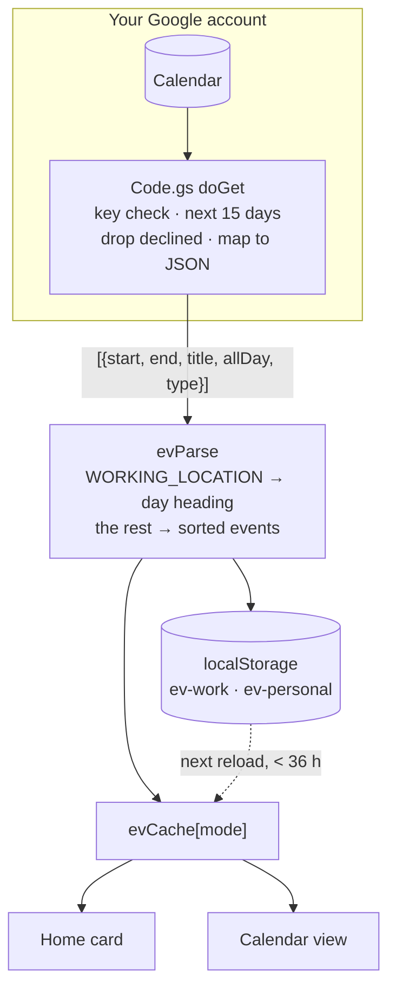

The work feed can take around 15 seconds to answer, so nothing waits for it. A reload shows the last good list from `localStorage` straight away. A failed fetch keeps the last good list and says "offline". Both modes are fetched every time, so switching modes never waits for Google. Working-location events (Home / Office) never become rows: they turn into the day's heading.

**Free time** is calculated on the clock: gaps of 15 minutes or more inside 09:00 to 17:00 on weekdays, in WORK only. The slot you're in right now is rendered live and counts down.

### The Home card is a state machine

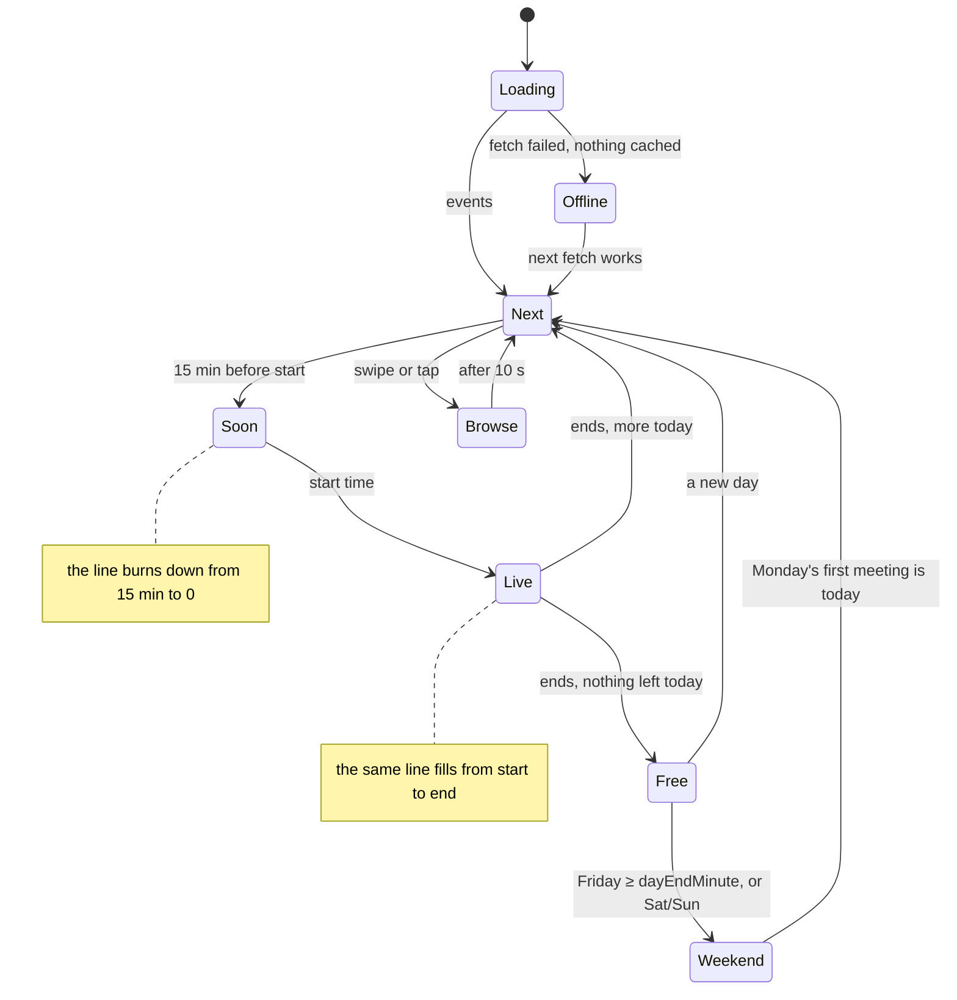

In PERSONAL the same slot shows the club instead: the live score (or the next match, or a result from the last 26 h), the league position and the last result, cycled by tap and back to the first after 10 s.

### Mode switch: one function, one choreography

`applyMode(m)` keeps the two lives apart:

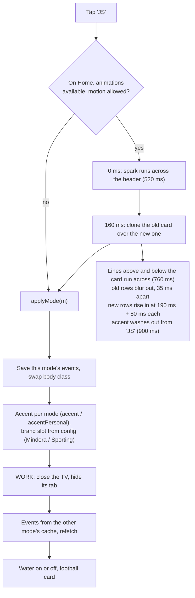

The wash layer is never removed: on this WebView, removing a layer that large blanks the header for one frame.

### Weather inside the digits

The digits are the weather display. A class on `<body>` (`wx-rain`, `wx-storm`, `wx-snow`, `wx-sun`, `wx-stars`, `wx-haze`) drives CSS inside the outlined minutes. Deciding which class takes two sources, because the forecast model often calls rain that isn't falling:

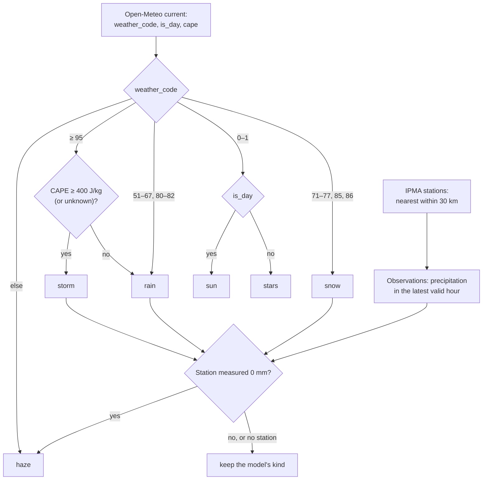

- **Lightning:** in a storm, the digits flash twice at a random 4 to 12 s interval.
- **Rain hitting the ground:** the digits are drawn once to an offscreen canvas at their real glyph positions. The columns where ink touches the baseline become the only places a drop can splash. Ripples and droplets run at about 30 fps while it rains and check twice a second otherwise.
- **Warnings:** IPMA's `warnings_www.json`, filtered to your district (`ipmaArea`), sea warnings left out. The worst warning active now wins. With none active, the next one coming is shown, and the temperature turns outlined in its colour.
- **Calendar:** each day's forecast high comes from the same 16-day request.

### Water: a schedule, not a counter

On work days in WORK mode, `N` glasses (Settings: 6 to 12, 250 ml each) are spread evenly from 09:00 to 17:00, each time rounded to 5 minutes:

```
tᵢ = round((540 + i · 480 / (N − 1)) / 5) · 5      minutes after midnight, i = 0 … N−1
```

With 9 glasses that's on the hour, 09:00 to 17:00. You're **behind** when fewer glasses are logged than times that have passed. The check runs only between 08:30 and 19:00.

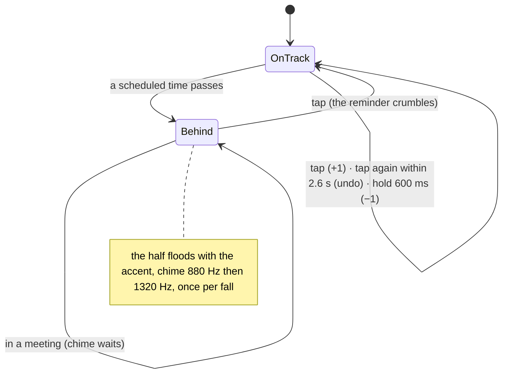

The count is stored as `{d: <today>, n}`, so it resets itself at midnight without a timer.

### Football from ESPN, with a live heuristic

Three requests run in parallel: the team's fixtures, its results (both across every competition) and the league table (`por.1` by default). Matches are de-duplicated by id and normalised to `TIMED`, `IN_PLAY`, `FINISHED` or `POSTPONED`. The free API can lag, so a match also counts as **live** when kick-off has passed, it isn't marked finished, and it started less than 120 minutes ago. While a match is live it polls every 60 s, otherwise every 10 minutes. The crest is loaded once, greyscaled, and also used as its own CSS mask, so the sheen that crosses it stays inside the crest's shape.

### Sleep, idle and sound

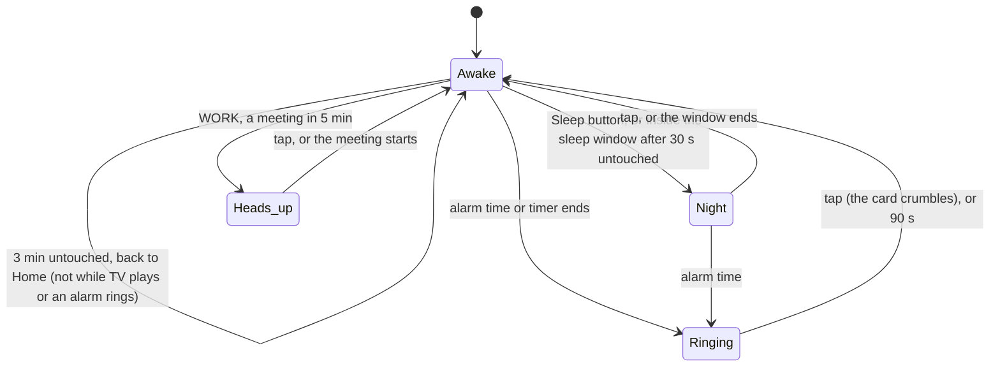

- **Night:** `#amb.night` with one ember tone on `#000`, and brightness set through `/bright`.
- **One card for everything that rings:** `ring(what, h, m, mins, meeting)` drives the alarm, the timer and the meeting heads-up. The alarm and the timer beep twice every 1.4 s, in step with the card's beat, and stop by themselves after 90 s; a meeting chimes once (two rising notes) and closes at its start time.
- **Tap to stop, the crumble:** the card is drawn into a canvas as it looks (its flood, every letter where it really is, filled or outlined), sampled on a 5 px grid, and each grain starts after a delay proportional to its distance from your finger. It trembles for 380 ms, then bursts outwards and falls under gravity while it fades. The backdrop fades at 700 ms, so the room comes back while the grain is still falling.
- **From Sleep:** the card turns ember red on black, and brightness ramps from the night's level to the day's over 30 s, in 2 s steps.
- **Meetings, once each:** checked on every new minute. The first non-all-day event starting in the next 30 s to 5 min shows the card; its start time and title are kept in `meetSeen`, so a reload doesn't show it again.
- **Quiet in meetings:** while a calendar event is on, beeps are suppressed and the TV is muted (and unmuted afterwards only if the clock muted it).

### State on the clock

| `localStorage` key | Holds |
|---|---|
| `mode` | `work` or `personal` |
| `accent` · `accentPersonal` | One accent per mode |
| `ev-work` · `ev-personal` | Last good calendar list with its timestamp |
| `water` | Today's glasses, keyed by date |
| `stepGoal` · `glassGoal` | Health goals |
| `alarms` | The alarm |
| `brightDay` · `muteMeetings` · `wxLive` · `tapTemp` · `crest` | Settings |
| `meetSeen` | The last meeting the heads-up was shown for |

### Private by construction

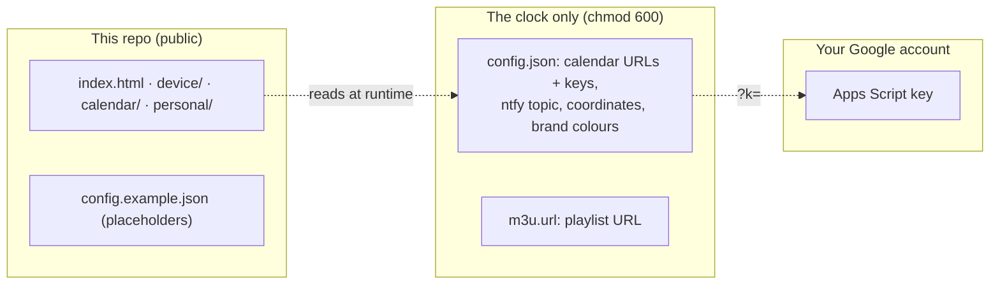

The Apps Scripts return `{"error":"forbidden"}` without the key. The work script holds the key in its source; the personal one generates it into Script Properties with `authorize()`. CI fails a push that tracks `config.json` or `m3u.url`, or that contains a real Apps Script deployment URL or steps topic.

### Writing for a 2019 browser

WebView 74 sets the rules, and [CI](.github/workflows/check.yml) enforces them on every push:

- No `?.`, `??` or `Animation.finished` (use `onfinish`).
- No CSS `inset`, `clamp()` or flex `gap`.
- Every inline script must parse.
- `shellcheck` runs on both device scripts.

Animations use the Web Animations API with `onfinish`, `-webkit-` mask and stroke prefixes, and `requestAnimationFrame` loops that slow down when idle. The big moments (the mode switch, the minute change, gliding titles, rain splashes, fireworks) check `prefers-reduced-motion` and fall back to a static change.

## Install

Companion Clock runs on a Mi Smart Clock that you've already set up with root access (Magisk) and [Fully Kiosk Browser](https://www.fully-kiosk.com). Unlocking a device can void its warranty; do it only on your own device and at your own risk. This repo doesn't cover that step.

Then follow [docs/setup.md](docs/setup.md): copy the files to the clock, add your `config.json`, point Fully at `http://localhost:8080/`, and deploy the calendar script.

## Credits

Crafted by [Jorge Sousa](https://jorgesousa.github.io). Built with [Claude](https://claude.ai). Type: [Inter Tight](https://github.com/rsms/inter) and [JetBrains Mono](https://www.jetbrains.com/lp/mono/) (SIL Open Font License). Video: [hls.js](https://github.com/video-dev/hls.js) (Apache 2.0).

## License

[Sustainable Use License 1.0](LICENSE.md): free for personal and non-commercial use.
